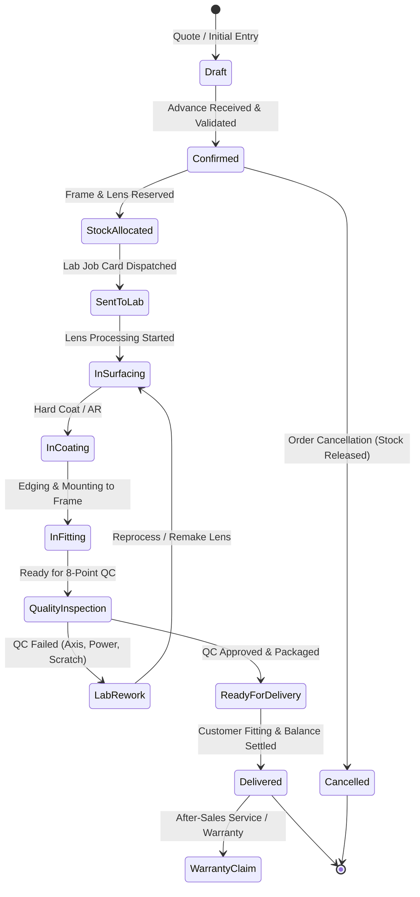

# Optical Store Management ERP — System Architecture & Technical Specification

## 1. Executive Architecture Summary
Optical Store Management ERP is an enterprise-grade, multi-company, multi-branch, multi-warehouse business automation platform engineered specifically for the optical retail, optometry clinic, spectacle manufacturing, and lens laboratory ecosystem.

The system is architected around a Clean Layered Architecture:
1. **Presentation Layer**: Responsive Laravel Blade + Livewire 3/4 + Alpine.js + Tailwind CSS, with barcode scanning, touch-friendly POS, real-time prescription calculators, and interactive job boards.
2. **Application / Service Layer**: Domain services isolating business logic (PrescriptionService, OrderLifecycleService, LaboratoryService, InventoryMovementService, GSTTaxEngine, JournalPostingService).
3. **Domain Layer**: Optical models with strict audit tracking, immutability of signed prescriptions, snapshotting of lab orders, and double-entry general ledger rules.
4. **Data Layer**: MySQL 8+ / MariaDB 10.4+ relational engine with strict foreign key constraints, composite index optimizations, transactional safety (`DB::transaction`), and audit logging.

```
+-----------------------------------------------------------------------------------+
|                            Optical Store Management ERP                           |
+-----------------------------------------------------------------------------------+
| Presentation:  POS / Livewire / Blade / TailwindCSS / Alpine.js / Chart.js        |
+-----------------------------------------------------------------------------------+
| Security & RBAC: Multi-Tenancy (Company/Branch Scope), Role-Based Permissions     |
+-----------------------------------------------------------------------------------+
| Domain Modules:                                                                   |
| [Prescriptions & Exams]    [Optical POS & Quotations]    [Sales Orders & Fitting]  |
| [Frames & Lenses Catalog]  [Lens Laboratory Workflow]    [Barcode & Inventory]     |
| [Indian GST & Invoicing]   [Ledger & Financial Accounts] [Repairs & Warranty]     |
+-----------------------------------------------------------------------------------+
| Service Layer:                                                                    |
|  - PrescriptionValidator     - LensMatrixCalculator     - InventoryReservation     |
|  - OrderLifecycleEngine      - LabStagePipeline         - DoubleEntryJournalEngine|
|  - GstCalculationService     - BarcodeGeneratorService  - NotificationEngine      |
+-----------------------------------------------------------------------------------+
| Persistence: Eloquent ORM + MySQL 8.0+ / MariaDB (Strict Foreign Keys & Auditing)  |
+-----------------------------------------------------------------------------------+
```

---

## 2. Separation of Workflows

The ERP explicitly decouples four critical, distinct operational workflows while maintaining real-time data flow between them:

### 2.1 Retail Workflow (Showroom & POS)
- **Role**: Front-desk optometrists, sales consultants, cashier.
- **Workflow**: Walk-in Customer Registration -> Optical Assessment / Prescription Selection -> Frame Selection (with bridge, temple, A/B/ED measurements) -> Lens Selection (index, material, coating, brand) -> Real-time Quotation / Order Generation -> Advance Payment & Deposit Collection -> POS Receipt / Tax Invoice.

### 2.2 Clinical & Prescription Workflow (Optometry)
- **Role**: Optometrists, Ophthalmologists, Refractionists.
- **Workflow**: Visual Acuity Exam (Unaided & Aided) -> Refraction (Subjective & Objective) -> Detailed OD (Right) & OS (Left) Spherical, Cylindrical, Axis, Add, Prism, Base -> Monocular & Binocular Pupillary Distance (PD) -> Fitting Heights, Pantoscopic Tilt, Vertex Distance -> Prescription Approval / Digital Signing -> Prescription History Archival.
- **Integrity Rule**: Prescriptions once signed/verified are immutable. Edits generate versioned revisions linked to previous prescriptions.

### 2.3 Laboratory & Fitting Workflow (Lens Surfacing & Edging)
- **Role**: Lab Manager, Edging Technician, QC Inspector.
- **Workflow**: Order Routing (In-house Lab vs External Wholesale Lab) -> Lab Job Card Generation (with complete lens & frame geometrical snapshots) -> Blank Lens Allocation & Blocking -> Surfacing / Polishing -> Coating (Hard Coat, AR, Blue Cut, Hydrophobic) -> Edging & Beveling (Rimless, Full-rim, Semi-rim groove) -> Frame Fitting -> 8-point Optical QC Check -> Pass/Fail Routing -> Pack & Dispatch to Showroom.

### 2.4 Accounting & Financial Workflow
- **Role**: Financial Controller, Accountant, Auditor.
- **Workflow**: Order Booking -> Advance / Split Payment Capture -> Automated GST Invoicing (Intra-state CGST+SGST vs Inter-state IGST) -> Automated Chart of Accounts Journal Posting -> Purchase Bill Voucher Matching -> Supplier Payments -> Expense Booking -> Cash Register Open/Close Balancing -> Trial Balance, P&L, and Balance Sheet.

---

## 3. Optical Sales Order Lifecycle State Machine



---

## 4. Multi-Branch Isolation & Security Strategy

- **Company & Branch Multi-Tenancy**: Every critical record belongs to a `company_id` and `branch_id`.
- **Global Scope Enforcement**: In Eloquent, `BranchScope` ensures users only see data belonging to their assigned branch, while Admins/Owners have multi-branch access.
- **Stock Guard**: Warehouse and counter stocks are tracked at `(branch_id, warehouse_id, product_id)`. Negative stock transactions are hard blocked.
- **Audit Trails**: Changes to sensitive records (Prescriptions, Orders, Payments, Stock Adjustments) generate immutable logs in `audit_logs` tracking `user_id`, `action`, `old_values`, `new_values`, and `ip_address`.

